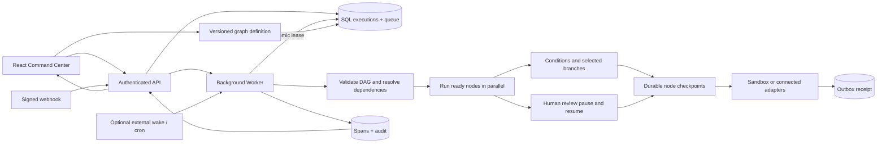

# IntegrationOS

**Your systems, in sync.** A working integration-operations core with a Command Center and an execution inspector built around persisted workflow traces.

This repository contains the **Phase 1 Core implementation**, including an executable drag-and-drop graph builder. See [the release checklist](docs/STATUS.md) for verified behavior and the external-account and production gates that still require deployment setup. Document Intelligence and PropertyOps are deliberately not scaffolded yet.

## Try the system

1. Open the application and sign in. A private workspace is provisioned for your identity.
2. Select **Initialize reference events**. Twelve events enter the real durable queue; the worker creates all timestamps, spans, receipts, and audit records. Repeated initialization is idempotent.
3. Watch the waterfall populate. Select any operation to inspect its input, output, attributes, and error.
4. Open **Execution Inspector**, choose **Urban Collective**, and filter its attempts. The reference scenario exhausts three retries and becomes a dead letter.
5. Select **Safe replay**. A linked execution runs without the injected fault. The original failure remains in history.
6. In **Workflow Studio**, publish the reference graph or create a new workflow. Drag steps from the palette, connect output/input handles, and configure a selected step. Conditions expose separate true/false ports. The configuration drawer also offers keyboard-accessible connection controls.
7. Add a transform, change its operation or value, connect it to an active route, and **Publish version**. Click **Test run**, then **Inspect trace**. The new node's actual output appears in its persisted span. Already-queued executions retain their original graph and layout.
8. Insert a **Human approval** step. The run pauses durably; approve or reject it in the inspector. Approval resumes the same execution and trace from saved checkpoints.

The builder supports 24 nodes and 48 connections, multiple workflows, undo/redo, node deletion, pan/zoom, minimap, auto-arrange, and validated JSON import/export. Supported nodes: event trigger, transform, condition, Slack delivery, HubSpot/Gmail reads, delay, human approval, and AI classification. Arbitrary code execution and arbitrary HTTP destinations are intentionally not supported.

Sandbox adapters never send an external message. All sandbox timing is measured around actual worker operations and explicit test-adapter latency. There are no fabricated historical timestamps, counters, or trace arrays in the UI.

## Architecture



The core is a modular monolith: `app/` contains the React interface and development route adapter, `core/` contains the independently testable orchestration and adapter modules, `db/` defines the schema, and `drizzle/` contains generated migrations. Production JSON requests are handled directly in `worker/`, outside the framework's server-rendering transformations. Framework and hosting glue lives in `worker/` and `scripts/`.

**Stack decision:** React 19, TypeScript, stable Vinext 1.4, Cloudflare Workers, D1 SQL, and Drizzle. The managed host runs the execution engine alongside the interface. The original FastAPI/PostgreSQL/Redis/Celery preference would require a different host; the trade-off and migration path are recorded in [ADR 001](docs/ARCHITECTURE.md).

Workspace settings now includes membership administration, sync review, verified encrypted backups and guarded retention. Recovery uses an owner-restricted maintenance endpoint with durable heartbeat records. See the [production runbook](docs/PRODUCTION-RUNBOOK.md) and [exact owner setup requirements](docs/OWNER-SETUP.md) before enabling live providers.

## Local development

Use **Node 24** and npm. On Windows ARM, run an x64 Node runtime under Windows emulation: the local Cloudflare runtime does not support native Windows ARM. Dependencies are locked.

```sh
npm ci
npm run build
npm run db:migrate:local
npm run dev
```

Open the printed loopback URL (normally `http://127.0.0.1:5173`). The starter's loopback-only development sign-in supplies a test identity. Production builds do not include that mock sign-in. Local and hosted SQL databases are separate.

Local schema changes: edit `db/schema.ts`, run `npm run db:generate`, inspect the generated SQL, build, then run `npm run db:migrate:local`. Never rewrite an applied migration. If an individual migration fails after partially applying, inspect the database before retrying; the helper intentionally does not suppress schema errors.

Optional `docker compose up --build` runs the development environment with a persistent local SQL volume using Linux host networking so the mock-auth boundary remains loopback-only. Docker Desktop requires host networking support enabled separately. This container is **not a self-hosted production auth solution**. Docker is supplied but was not executable in the authoring environment. Use the native loopback workflow for the validated development path.

## Checks

```sh
npm test
npm run typecheck
npm run build
npx playwright install chromium
npm run test:e2e
```

Tests cover concurrent claims, duplicate events, idempotency conflicts, retries, dead letters, receipt reuse after lease expiry, uncertain delivery, tenant isolation, roles, origin checks, version conflicts, encryption, webhook authentication, adapters, and OTLP conversion. Graph tests additionally verify branches, parallel dependency timing, joins, checkpoints, independent action receipts, approval authorization, reject/resume semantics and graph validation. Browser tests exercise canvas editing, connections, publication, node outputs in the inspector, approval decisions, reload persistence, integration controls and mobile overflow. The built Worker uses its own migrated `.wrangler/e2e` database, separate from the development preview. Tests emulate the trusted gateway's identity headers only on loopback; they do not exercise real hosted sign-in. `.github/workflows/ci.yml` defines the Linux CI checks; GitHub-hosted execution remains unverified.

## Live integrations

Configure secrets through the hosting environment UI; use an ignored `.dev.vars` for local development. Variable names are documented in `.env.example`. Never put tokens in the browser or the hosting manifest.

For each provider, register an OAuth application and allow exactly:

```text
https://YOUR_ORIGIN/api/connections/slack/callback
https://YOUR_ORIGIN/api/connections/hubspot/callback
https://YOUR_ORIGIN/api/connections/gmail/callback
```

Set the relevant client ID and client secret plus a cryptographically random `TOKEN_ENCRYPTION_KEY` of at least 32 characters. The Integration Hub then enables authorization. Tokens use AES-256-GCM with workspace/provider-bound associated data. OAuth state is random, hashed, user-bound, expiring, and consumed once. Refreshable tokens refresh before expiry.

After Slack authorization, set its real channel ID in Workflow Studio, choose **Live**, and publish. The event launcher then offers an explicit **Live Slack delivery** option. Each such run sends the configured notification. Sandbox remains the launcher default even when live delivery is configured.

For live AI classification, configure `OPENAI_API_KEY` and `OPENAI_MODEL` through secret settings. The Responses API uses a strict enum schema and validates the returned category again. Sandbox classification deterministically returns the first category and explicitly labels the result `sandbox-test-adapter`; it is not represented as a model inference. Credentials were unavailable for live AI verification.

HubSpot and Gmail currently support authorization and a bounded first-page read with a persisted metadata summary. These are **not continuous or bidirectional sync engines**. Provider sandbox credentials were not supplied, so actual OAuth consent and live provider actions still require validation. No real third-party action was executed during development.

## Webhooks and recovery

See [the operations guide](docs/OPERATIONS.md) for signed ingestion, authentication boundaries, wake endpoints, retry policy, OTLP export, backups, and rollout checks. The private Site's access boundary remains in front of every endpoint, including webhooks. An external CRM cannot reach a private Site merely by supplying the application HMAC; an authorized service-access path is also required. Do not make the Site public to work around this.

## Source and deployment

The local repository and managed Sites Git remote contain the source. `.openai/hosting.json` retains the exact Site identity. The Sites source helper builds, commits, pushes, and packages a deployable archive; native publishing applies migrations and deploys that exact version privately. GitHub repository creation is not exposed by the available GitHub connector, so this release does not claim a GitHub URL.

## Design

Layered midnight surfaces, Manrope typography, icy-blue controls, restrained illumination, an orchestration diagram and meaningful status colors. **GSAP** provides scoped view transitions, **Lenis** handles page scrolling while leaving canvas and nested interaction areas native, and **React Bits SpotlightCard** adds subtle proximity illumination to metrics. React Flow provides the editable graph. Motion respects reduced-motion preferences. The inspector preserves attempts and measured overlap, supports JSON inspection and export, and places human decisions beside their evidence. The supplied attachment contained the written brief only; no reference screenshot was available for pixel comparison.

React Bits source is vendored with its full MIT + Commons Clause license in `components/reactbits/LICENSE.md`. See [third-party notices](docs/THIRD_PARTY.md).

## Provider references

- [Slack chat.postMessage](https://api.slack.com/methods/chat.postMessage)
- [HubSpot OAuth API migration](https://developers.hubspot.com/changelog/v1-oauth-api-deprecation)
- [Gmail messages.list](https://developers.google.com/workspace/gmail/api/reference/rest/v1/users.messages/list)
- [Cloudflare background waitUntil](https://developers.cloudflare.com/changelog/post/2025-08-08-add-waituntil-cloudflare-workers/)

Read [security and reliability decisions](docs/SECURITY.md) before connecting sensitive production accounts.
