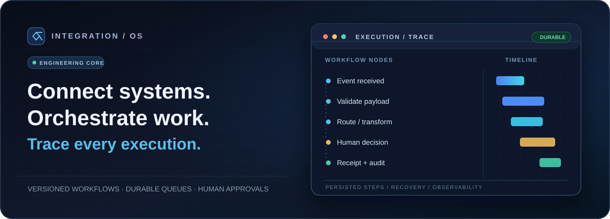
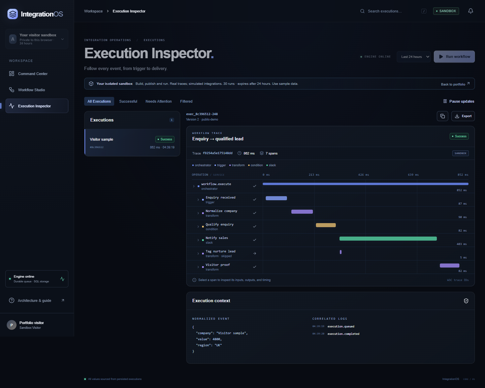
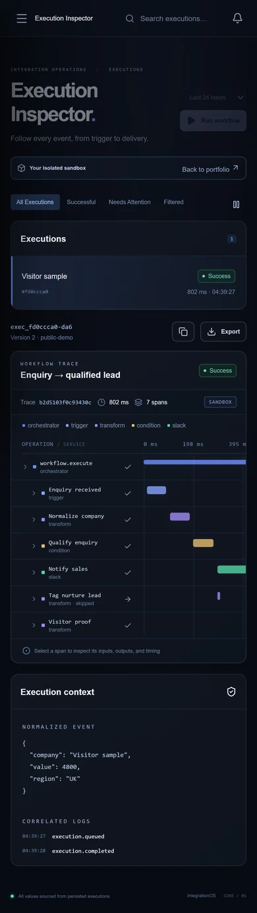
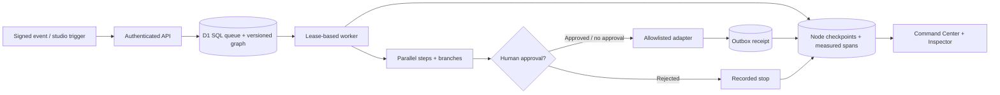

<p align="center">
  
</p>

# IntegrationOS

**Connect systems. Orchestrate work. Trace every execution.**

IntegrationOS is a full-stack **integration and workflow-operations platform**: a visual, versioned workflow builder backed by real SQL-persisted execution, recovery, human approvals, integration adapters, and trace-level observability. It combines a polished React command center with the engineering controls needed to inspect and recover complex business processes.

**[Interactive Workflow Studio](https://integrationos.digitalprodigy.dev/demo)** · **[Portfolio overview & recorded traces](https://integrationos.digitalprodigy.dev)** · [Architecture](docs/ARCHITECTURE.md) · [Verified scope](docs/STATUS.md) · [Public demo boundaries](docs/PUBLIC-DEMO.md)

> **Portfolio reference implementation — Phase 1 Core.** The public Studio runs **real persisted workflows with clearly labelled sandbox adapters**. It does *not* send messages to third-party providers. Live Slack, HubSpot, Gmail and AI-provider acceptance still requires separate credentials and testing. This is engineering proof, not a claim that a customer CRM deployment has been certified.

---

## The problem

Businesses depend on CRMs, email, internal tools, and APIs that don't naturally share state. When processes cross those systems, failures become difficult to diagnose: an event can be accepted but never delivered, a retry can repeat an external action, or a manual approval can be lost after a restart.

**IntegrationOS brings the workflow and its evidence together.** An operator can design the graph, publish a version, execute it against a durable queue, inspect measured spans and outcomes, and decide whether to approve, retry or investigate an uncertain delivery.

## Experience the product

The public [interactive Studio](https://integrationos.digitalprodigy.dev/demo) uses isolated 24-hour visitor workspaces. No account credentials or provider integrations are needed.

1. **Design:** Drag nodes onto the canvas, connect branches, configure transformations, conditions, delays and approvals.
2. **Publish:** Validate and publish a graph version. Invalid cycles, unsafe fields and unsupported connections are rejected server-side.
3. **Execute:** Trigger a sandbox run using the actual workflow engine and SQL queue.
4. **Inspect:** Follow the persisted execution waterfall, node outputs, branch decisions, checkpoints and errors.
5. **Intervene:** Resolve an approval, test a retry, or inspect an execution after reload.

For a curated, read-only introduction with recorded engine traces, open the [portfolio walkthrough](https://integrationos.digitalprodigy.dev).

### Product screenshots

**Execution Inspector — desktop**



<details>
<summary>View the responsive mobile Execution Inspector</summary>

<p align="center">
  
</p>

</details>

The graphic above is **an illustrative architecture motif, not an application screenshot**. The linked experiences are the actual deployed application.

## Core product experiences

| Area | What works |
| --- | --- |
| **Command Center** | Engine-derived operational metrics, execution activity, integration health and failure inspection. |
| **Workflow Studio** | React Flow drag-and-drop canvas, configuration, branches, undo/redo, pan/zoom, minimap, validated JSON import/export and version publishing. |
| **Execution Inspector** | Measured trace spans, parallel-step waterfall, redacted inputs/outputs, attempts, errors, receipts and linked replay history. |
| **Execution engine** | Durable SQL queue, lease claims, parallel dependency execution, deterministic routing, checkpoints, backoff, retries and dead letters. |
| **Human approvals** | Persisted waiting state, authorized approve/reject decisions and resume from the existing checkpoint. |
| **Integrations** | OAuth/credential lifecycle, restricted provider adapters, opt-in synchronization, durable cursors and staged HubSpot contact updates. |
| **Workspace operations** | Owner/member controls, roles, quotas, audit trails, verified encrypted backups and guarded retention. |
| **Public portfolio sandbox** | Isolated visitor tenants with genuine engine execution; no live provider access or workspace administration. |

**Graph boundaries:** At most 24 nodes and 48 connections per graph; conditions expose explicit true/false routes. The engine does not execute arbitrary user code or send requests to arbitrary user-provided URLs.

## A real end-to-end execution



- **Persistence is real:** Executions, graph snapshots, step results, retries and trace spans are stored by the backend, not fabricated in the browser.
- **Failures are explicit:** Bounded retries and dead-letter states distinguish confirmed failure from uncertain delivery, which requires manual review.
- **Replay is auditable:** A replay links to its originating execution; confirmed external receipts are reused where applicable.
- **Recovery is unattended:** An hourly managed task has been verified recovering an expired execution lease on the hosted service.
- **Visibility is linked to action:** Execution IDs, persisted span IDs and correlation information connect orchestration, debugging and the audit history.

See the deeper [architecture decisions](docs/ARCHITECTURE.md) and [operations runbook](docs/PRODUCTION-RUNBOOK.md).

## Engineering and design

| Layer | Implementation |
| --- | --- |
| **Frontend** | React 19, TypeScript, Tailwind CSS, shadcn-style components, React Flow, GSAP, Lenis and React Bits effects |
| **Application/runtime** | Vinext 1.4 / Next-compatible application, Cloudflare Workers |
| **Persistence** | Cloudflare D1 SQL, Drizzle schema and additive migrations |
| **Workflow orchestration** | Leased SQL queue, immutable published graph snapshots, dependency scheduling, receipts, retry/replay and approvals |
| **Observability** | Measured execution spans, OpenTelemetry SDK, durable OTLP export outbox and inspection UI |
| **Reliability** | Recovery task, scoped rate limits, fenced OAuth refresh, AES-GCM token encryption, encrypted R2 logical backups |
| **Quality** | Node test runner, TypeScript checks, Playwright desktop/mobile tests, GitHub Actions and Docker smoke-test configuration |

The architecture is deliberately a **modular monolith**. The UI and engine run on one managed Worker-backed deployment; it does **not** claim to run a FastAPI/Celery/PostgreSQL microservice infrastructure. The alternative architecture and trade-offs are recorded in [ADR 001](docs/ARCHITECTURE.md).

### Integration state — implemented vs. verified live

| Adapter | Implemented capability | Live-provider acceptance |
| --- | --- | --- |
| **Slack** | Scoped OAuth/connection and outbound message action with durable delivery handling | **Pending** test workspace consent and provider receipt verification |
| **HubSpot** | OAuth, paginated read/sync with persisted cursor, staged existing-contact edits and conflict review | **Pending** disposable portal and provider-side write/readback |
| **Gmail** | Read-only OAuth and message mirror/sync; no send/write scopes | **Pending** test mailbox authorization and remote readback |
| **AI classification** | Validated structured output path and explicit sandbox classification | **Pending** configured model, cost policy and real API test |
| **External traces** | Durable OTLP export outbox and local HTTP collector test | **Pending** production collector endpoint and credentials |

**No Salesforce integration, native CRM webhook-signature adapter, autonomous production CRM writeback or live AI-model quality is claimed.** HubSpot two-way sync is opt-in and requires a single-writer/conflict acceptance policy.

## Security and reliability boundaries

- Workspace isolation, authenticated owner endpoints and role checks; the public visitor API is a separate allowlisted sandbox surface.
- Signed generic webhooks, origin checks, bounded event payloads, encrypted provider credentials and redacted traces.
- Server-side graph validation, action allowlists, rate limits and execution quotas.
- At-least-once execution with conservative uncertain-delivery handling — **not a blanket exactly-once guarantee** across SaaS providers.
- Public sessions use isolated, expiring synthetic tenants and cannot enable live actions, inspect owner data or administer integrations.
- Offsite disaster recovery, independent security review, live-provider acceptance and defined production SLOs remain **outside the verified scope**.

[Security decisions](docs/SECURITY.md) · [Public demo isolation and limits](docs/PUBLIC-DEMO.md)

## Verified technical evidence

At the current Phase 1 release:

- **48 backend tests** and **16 desktop/mobile browser checks** passed in the release validation.
- **TypeScript checks**, **production build** and a dependency audit with **zero reported vulnerabilities at release time** passed.
- **Two GitHub Actions CI runs passed** after repository publication, including the configured verification jobs.
- Hosted recovery and encrypted R2 backup readback were verified. A local 100-execution/10-tenant bounded load check passed; this is **not** a production performance certification.

[GitHub Actions results](https://github.com/ProdigyProjectStudios/integrations-os/actions) · [Implementation status and precise acceptance gates](docs/STATUS.md)

## Run locally

Use **Node.js 24** and npm. This repository is a Cloudflare Worker/D1 implementation; no separate PostgreSQL or Redis server is required for the validated local path.

```bash
npm ci
npm run build
npm run db:migrate:local
npm run dev
```

The local development sign-in works only on loopback; hosted authentication is enforced separately. Never reuse a production database for browser or test fixtures.

```bash
npm test
npm run typecheck
npm run build
npx playwright install chromium
npm run test:e2e
```

Configure secrets through hosting environment settings or an ignored local `.dev.vars`; `.env.example` documents the variable names. **Never commit live tokens or API keys.** For OAuth scopes and exact callback URLs, use [OWNER-SETUP.md](docs/OWNER-SETUP.md).

## Repository map

```text
app/                   Command Center, Workflow Studio, portfolio and demo UI
components/            UI components and licensed React Bits integration
core/                  Graph executor, adapters, security, sync and recovery
db/                    SQL schema and data model
drizzle/               Generated, additive database migrations
worker/                Deployed API, isolation and background execution boundary
tests/                 Engine, security and browser coverage
docs/                  Architecture, security, operations and status runbooks
.github/workflows/      CI and Docker verification
```

## Documentation

- [Architecture and engineering trade-offs](docs/ARCHITECTURE.md)
- [Operations, ingestion, recovery and telemetry](docs/OPERATIONS.md)
- [Production runbook](docs/PRODUCTION-RUNBOOK.md)
- [Owner setup and live-provider acceptance](docs/OWNER-SETUP.md)
- [Public demo threat model and isolation](docs/PUBLIC-DEMO.md)
- [Third-party notices](docs/THIRD_PARTY.md)
- [Phase 1 implementation status](docs/STATUS.md)

## Scope and next phases

**Phase 1 Core is implemented and demonstrable.** It should be presented as a workflow and integration infrastructure engineering reference, **not** as an already-certified customer-facing integration service. Document Intelligence and PropertyOps are **separate, unbuilt future phases** and are not represented as functionality in this repository.

## Author and licence

**Aaron Archer · Digital Prodigy** — independent AI & full-stack engineer  
[Portfolio](https://digitalprodigy.dev) · [GitHub profile](https://github.com/ProdigyProjectStudios)

Copyright © 2026 Aaron Archer. The source is available for portfolio evaluation and technical review only. No reuse or commercial licence is granted. See [LICENSE](LICENSE). Third-party components retain their own licences.
